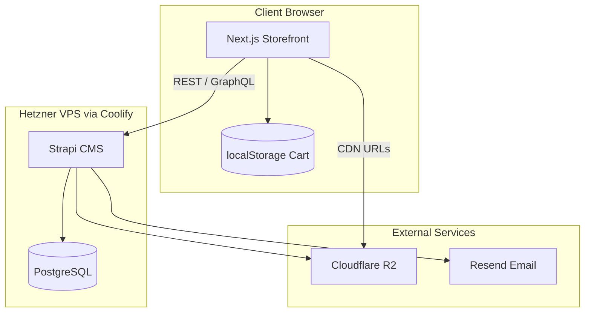

# PlanBlue Architecture

## High-level diagram

## Monorepo packages

| Package | Role |
|---------|------|
| `@planblue/web` | Public storefront (Next.js App Router) |
| `@planblue/cms` | Headless CMS, admin dashboard, APIs, crons |
| `@planblue/shared` | Shared types & constants (cart keys, DTOs) |
| `@planblue/email` | React Email templates consumed by Strapi |

## Data flow — guest checkout

1. Customer browses products fetched from Strapi.
2. Cart lives entirely in browser `localStorage` (no login).
3. Checkout form collects **name, phone, email** (+ optional promocode).
4. Next.js POSTs order payload to Strapi custom endpoint.
5. Strapi validates promocode → marketer → commission, persists order.
6. Strapi sends confirmation email via Resend using `@planblue/email`.

## Admin & analytics (later)

- **Active users:** middleware or plugin tracking sessions.
- **Product views:** increment counter on product detail API hit.
- **Daily cron:** Strapi bootstrap cron → aggregate sales/commissions → email admins/accountants.

## Deployment (Coolify)

| Service | Port | Notes |
|---------|------|-------|
| `web` | 3000 | Next.js standalone or Node build |
| `cms` | 1337 | Strapi; persistent volume for cache only (uploads → R2) |
| `postgres` | 5432 | Internal network only |

Environment variables are injected per-service in Coolify; never commit production secrets.

## Security notes

- Strapi admin JWT for dashboard only; storefront has no customer JWT.
- Public API permissions scoped per content-type (read products; create orders only).
- `STRAPI_API_TOKEN` on Next.js server for ISR/SSG if needed (not exposed to client).
